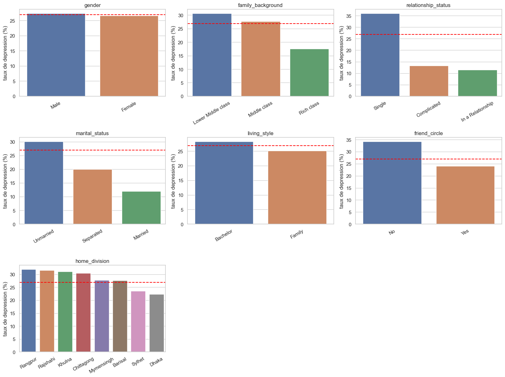
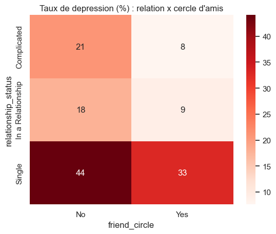

# Facteurs associés à la dépression chez les étudiants

Analyse exploratoire et statistique d'un sondage auprès de 4 464 étudiants, pour identifier les profils les plus associés à la dépression.

 **[Voir le notebook sur Kaggle](https://www.kaggle.com/code/nassersimon/student-depression-analysis-eda)** · 

---

## Résumé

- **Question :** quels profils d'étudiants sont les plus associés à la dépression ?
- **Méthode :** exploration, nettoyage, analyse visuelle, tests statistiques (chi², Mann-Whitney) et vérification de robustesse.
- **Résultat principal :** le statut de relation est le facteur le plus lié à la dépression (36 % chez les célibataires contre 11,5 % chez les étudiants en couple). L'isolement social, un jeune âge et un milieu modeste ressortent aussi.
- **Point d'attention :** la variable `Health_condition` prédit presque parfaitement la cible (V de Cramér ≈ 0,81). Elle est suspecte et a été exclue des conclusions.

## Données

| | |
|---|---|
| **Source** | [Student Depression Detection Dataset](https://www.kaggle.com/datasets/mkhoirulmustaqim/student-depression-detection-dataset) par MKhoirul Mustaqim (Kaggle) |
| **Taille** | 4 464 lignes, 13 colonnes (12 variables + 1 cible) |
| **Cible** | `Depression` (Yes/No), 26,9 % de « Yes » |
| **Origine** | Sondage mené au Bangladesh |
| **Licence** | CC BY-SA 4.0 |

Aucune valeur manquante ni doublon. 50 lignes suspectes (semestre 0, coût à 0, étudiants de 18 ans ou moins mariés) ont été marquées et conservées.

## Méthode

1. **Exploration** : structure, types, valeurs manquantes, répartition de la cible.
2. **Nettoyage** : copie de travail, noms de colonnes en minuscules, cible en 0/1, marquage des lignes suspectes, création de tranches d'âge et de notes.
3. **Analyse** : distributions, taux de dépression par catégorie, croisement relation × cercle d'amis.
4. **Tests statistiques** : chi² et V de Cramér (variables catégorielles), Mann-Whitney (variables numériques).
5. **Robustesse** : résultats comparés avec et sans les lignes suspectes.

## Résultats clés

| Facteur | Constat |
|---|---|
| Statut de relation | Célibataires 36 % · en couple 11,5 % (V ≈ 0,26, lien le plus fort) |
| Statut marital | Mariés 12 % · non mariés 30 % (V ≈ 0,15) |
| Cercle d'amis | Sans amis 34 % · avec amis 24 % (V ≈ 0,10) |
| Âge | 17-20 ans : 33 % · 24 ans et plus : 23 % |
| Notes (CGPA) | 3,0 ou moins : 36 % · plus de 3,8 : 22 % |
| Milieu familial | Aisé 18 % · classe moyenne inférieure 31 % |
| Genre, semestre | Pas d'effet clair |

Retirer les lignes suspectes change les taux de moins d'un point : les résultats sont stables.

## Aperçu





## Limites

- Ce sont des **associations, pas des causes** : l'analyse ne permet pas de dire que le célibat provoque la dépression.
- Les données viennent d'un sondage au Bangladesh : elles ne s'appliquent pas automatiquement à d'autres pays.
- La façon dont la dépression a été mesurée n'est pas précisée, et le dataset peut contenir des données simulées.
- Seulement 12 variables : des facteurs importants (sommeil, stress, finances détaillées) manquent.
- Ce projet décrit un échantillon. Il ne fournit aucun diagnostic ni avis médical.

## Pistes pour aller plus loin

- Construire un modèle prédictif (en excluant `Health_condition`) et comparer plusieurs algorithmes.
- Comparer avec un dataset d'une autre région.

## Structure du dépôt

```
student-depression-analysis/
├── analysis.ipynb                      # notebook complet
├── data/
│   ├── Student_Depression_Dataset.csv  # données d'origine
│   └── student_depression_clean.csv    # données nettoyées
├── images/                             # captures utilisées dans ce README
├── requirements.txt
└── README.md
```

## Reproduire l'analyse

```bash
git clone https://github.com/simon4447/student-depression-analysis.git
cd student-depression-analysis
pip install -r requirements.txt
jupyter notebook analysis.ipynb
```

## Technologies

Python · Pandas · NumPy · Matplotlib · Seaborn · SciPy · Jupyter

## Auteur

**Simon**, développeur et passionné de data, basé à Douala (Cameroun).
GitHub : [simon4447](https://github.com/simon4447) ·

---

*Données : MKhoirul Mustaqim, [Student Depression Detection Dataset](https://www.kaggle.com/datasets/mkhoirulmustaqim/student-depression-detection-dataset), licence CC BY-SA 4.0.*
